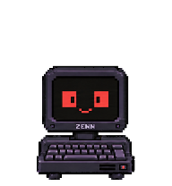

# Zenek Desktop Companion

[](https://github.com/piotr-adamski/zenek-desktop/actions/workflows/ci.yml)
[](LICENSE)

A small animated GNOME companion that chats, notices your desktop when invited,
and develops a fictional personality over time. Built for play and curiosity,
with local encrypted memory and an unhurried voice.



**[0.2.0 public preview](https://github.com/piotr-adamski/zenek-desktop/releases/tag/v0.2.0).** Linux, GNOME Shell **50 / Wayland**, Python **3.12+**.
The current UI and default persona are Polish. Native desktop testing used
Ubuntu 26.04.1 / GNOME 50.1; other distributions are not yet validated.

## What it does

- ZENN animations follow activity: sleeping at rest, blinking during observation,
  typing while preparing a reply. A separate bubble accepts your answer.
- Independent conversation, background and vision profiles use your own
  authorization through **Continue with ChatGPT**.
- Optional periodic screenshots use XDG Portal/PipeWire, local OCR and redaction.
  Graphics can trigger vision. The capture session closes between snapshots;
  a tray toggle keeps your choice across session pauses.
- Topic repetition filters and rotating perspectives make spontaneous comments
  less monotonous. Silence is allowed; frequency and budgets are configurable.
- A simulated self model develops identity, values, beliefs, questions, taste,
  aspirations, tensions, relationship and metacognition. Revisions keep sources,
  confidence and history. This is fictional character development.
- SQLCipher memory supports explicit archive import, corrections and export.
  Keys/credentials stay in the system Keyring. Optional public web research uses
  a separate Bubblewrap sandbox and public HTTPS GET only.
- Conversation and background models can call memory, public research and
  notebook tools. Zenek applies its own character changes with version history.
  It writes knowledge, journals and notes under `notebook/` in its source repo;
  code changes remain the owner's work and can be requested by Zenek.
- **Notatnik**, **Historia rozmów** and **Rozwój Zenka** in the tray open a native
  reading and conversation window. Notes and conversations support full-text
  search, source links and returning to an earlier topic. The bubble keeps its
  small form and has a **Większe okno** button.
- After speaking, Zenek can reflect privately, plan a later return, research,
  write a note, adopt a hobby or leave a topic behind. Private interests can
  develop without spontaneous messages. These are durable creative choices of
  the simulated character.

Local storage does **not** mean local inference: selected conversation/context
and, when enabled, redacted screen material are sent directly to OpenAI. There is
no project-hosted backend or telemetry. Read the [privacy model](docs/privacy.md).

## Get started

Install native prerequisites from [the installation guide](docs/installation.md),
then run as your desktop user:

```bash
git clone --branch v0.2.0 https://github.com/piotr-adamski/zenek-desktop.git
cd zenek-desktop
bash scripts/install-user.sh --check
bash scripts/install-user.sh
~/.local/bin/zenek start
~/.local/bin/zenek settings
```

Installation creates a **user** service and extension. Fresh installations have
autostart, screen capture and web research OFF. First extension discovery may
require signing out/in. Keep the source folder: the service runs its virtual
environment. No system service or GDM changes are made.

In Settings, choose **Continue with ChatGPT**, complete registration/consent,
then select and test the profiles offered to your account.
[Account setup](docs/configuration.md#account-and-models) explains per-user
registration. No shared API key is supplied; paid API use requires a separate choice.

```bash
zenek show       # show the companion
zenek hide       # keep Core running
zenek stop       # stop the user service
zenek status
zenek notebook   # read and discuss Zenek's own notes
zenek chat       # searchable conversation history
zenek development # character changes, reasons and own choices
```

Use `~/.local/bin/zenek` if that directory is not on your PATH.

## Documentation

| Guide | Contents |
| --- | --- |
| [Installation](docs/installation.md) | Dependencies, setup, updates, removal, troubleshooting |
| [Configuration](docs/configuration.md) | Sign-in, profiles, snapshots, interruptions, personality |
| [Architecture](docs/architecture.md) | Core, UI, storage, capture, web broker and simulated self |
| [Autonomy and tools](docs/autonomy.md) | Character development, private hobbies, plans, notebook and boundaries |
| [Privacy](docs/privacy.md) | Storage, network destinations, redaction and limitations |
| [Testing](docs/testing.md) | Automated checks, native verification scope and gaps |
| [Roadmap](docs/roadmap.md) | Priorities for the next preview |
| [Releasing](docs/releasing.md) | Versioning, verification and public source releases |

[Contributing](CONTRIBUTING.md), [security reports](SECURITY.md),
[Code of Conduct](CODE_OF_CONDUCT.md), [changelog](CHANGELOG.md).

## License and status

Independent open-source project maintained by [Piotr Adamski](https://github.com/piotr-adamski).
Source, docs and original Zenek/ZENN artwork use [Apache-2.0](LICENSE), except the
separately attributed Code of Conduct and DCO texts. See [NOTICE](NOTICE) and
[third-party notices](THIRD_PARTY_NOTICES.md).

Source installation is the supported distribution route. There is no PyPI,
Flatpak or GNOME Extensions catalog release. Zenek is not an official OpenAI,
ChatGPT, Codex or GNOME product.
