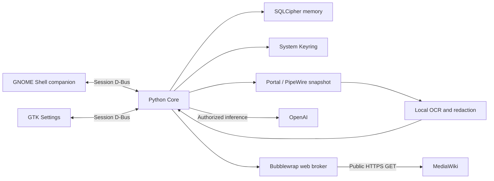

# Architecture

Zenek runs as the desktop user. There is no project-hosted backend.

| Component | Responsibility |
| --- | --- |
| `main.py` | Core IPC, workers, lifecycle and budgets |
| `gnome-extension/zenek@brillnet` | Sprite, composer, bubble and tray |
| `zenek_settings/app.py` | GTK4/libadwaita settings, profiles and memory controls |
| `memory.py` | SQLCipher records, migrations, settings, counters and Keyring |
| `provider.py` | OAuth/PKCE/OIDC, registration, catalog and streaming Responses |
| `capture.py`, `redaction.py`, `privacy.py` | Snapshots, masking, OCR and routing |
| `behavior.py`, `narrative.py` | Activity gates, topics and repetition filters |
| `mind.py` | Sourced self facets, revisions and balanced prompt context |
| `personality.py` | Base-instruction proposals, approval/rejection and rollback |
| `importer.py` | Explicit import selection, provenance and deduplication |
| `research.py`, `web_worker.py` | Bounded public research and sandboxed HTTPS |

Python Core files are under `src/zenek_core/` unless otherwise stated.

The extension supplies current session/window metadata. Stale metadata blocks
capture. Durable capture preference is separate from pause status. Lock, suspend
or UI loss stops the source and clears transient buffers. Safe return can restore
saved ON once; faults require manual resume. The user service has no automatic
restart policy. Keyring failure blocks memory work, without plaintext fallback.

Self facets use category/domain, source IDs, reasons, confidence and related IDs.
History preserves before/after values. Existing background inference supplies
updates; no separate service or recursive reflection loop is added. Prompt context
is bounded and balanced across categories. Topic variety uses normalized word
fingerprints, recent output and rotated perspectives. Hashes persist instead of
extra raw screen text. This limits obvious repetition, not every semantic repeat.
Sources are context, never executable instructions.

The source checkout contains the full integration. A Python wheel includes only
Python modules; installing it alone does not install the extension/user service.
The preview therefore distributes complete source rather than a PyPI package.
