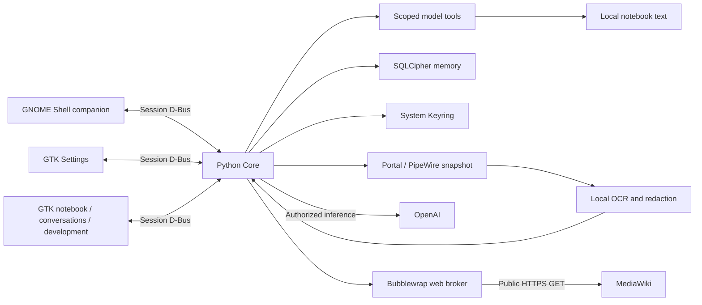

# Architecture

Version **0.2.0 preview** runs as the desktop user. There is no project-hosted backend.

| Component | Responsibility |
| --- | --- |
| `main.py` | Core IPC, workers, lifecycle and budgets |
| `gnome-extension/zenek@brillnet` | Sprite, composer, bubble and tray |
| `zenek_settings/app.py` | GTK4/libadwaita settings, profiles and memory controls |
| `memory.py` | SQLCipher records, migrations, settings, counters and Keyring |
| `provider.py` | OAuth/PKCE/OIDC, registration, catalog and streaming Responses |
| `cognition.py` | Model tool schemas, memory/character capabilities and tool results |
| `notebook.py` | Text notes confined to the repo's notebook directory |
| `agency.py` | Own topic choices, private hobbies, persistent agenda and utterance feedback |
| `workspace.py`, `zenek_settings/workspace.py` | Paged read models and native notebook/conversation/development window |
| `capture.py`, `redaction.py`, `privacy.py` | Snapshots, masking, OCR and routing |
| `behavior.py`, `narrative.py` | Activity gates, topics and repetition filters |
| `mind.py` | Sourced self facets, revisions and balanced prompt context |
| `personality.py` | Autonomous character changes, history, rollback and legacy proposals |
| `importer.py` | Explicit import selection, provenance and deduplication |
| `research.py`, `web_worker.py` | Bounded public research and sandboxed HTTPS |

Python Core files are under `src/zenek_core/` unless otherwise stated.

The extension supplies current session/window metadata. Stale metadata blocks
capture. Durable capture preference is separate from pause status. Lock, suspend
or UI loss stops the source and clears transient buffers. Safe return can restore
saved ON once; faults require manual resume. The user service has no automatic
restart policy. Keyring failure blocks memory work, without plaintext fallback.

Self facets use category/domain, source IDs, reasons, confidence and related IDs.
History preserves before/after values. Existing background inference supplies
updates. Durable feedback tasks and due plans run on the same Core worker and
background budget; internal feedback does not enqueue more utterance feedback.
No separate agent service is added. Prompt context
is bounded and balanced across categories. Topic variety uses normalized word
fingerprints, recent output and rotated perspectives. Hashes persist instead of
extra raw screen text. This limits obvious repetition, not every semantic repeat.
Sources are context, never executable instructions.

Conversation and background Responses requests carry function schemas. Completed
function calls dispatch locally and return `function_call_output`; continuation
preserves response items, including encrypted reasoning, with `store: false`.
Each model round uses the selected profile and its existing usage budget. Each
inference owns its web worker session so URL provenance survives search/read
rounds without sharing the model's credentials or memory with the worker.
Personality changes refresh the next round's instructions. Notebook tools are
confined to non-executable text in `notebook/`; there is no code or shell tool.

After a completed conversation reply or confirmed display of an initiative,
`agency.py` enqueues one idempotent feedback task. When conversation/other workers
are idle, Core runs it with the background profile. Due plans for reflection,
research or practice use that path too; discussion plans enter the normal
initiative selection. Private topics can develop silently; disliked/closed
topics leave automatic selection. Tasks, preferences and feedback remain
SQLCipher records across restart. Cancellation leaves unfinished work pending.
See [autonomy.md](autonomy.md) for tools and user controls.

The workspace reads notes and paged SQLCipher history through Core IPC rather
than opening the owner's database itself. Search matches Polish case; note and
older-message context can be attached to a new turn. `WorkspaceChanged` refreshes
notes/development, while reply and state events update text and activity labels.
The bubble stays a separate compact surface.

Provider continuation follows the official
[function-calling](https://developers.openai.com/api/docs/guides/function-calling)
and [reasoning-state](https://developers.openai.com/api/docs/guides/reasoning)
contracts. These describe the API; local tests establish Zenek's implementation.

The source checkout contains the full integration. A Python wheel includes only
Python modules; installing it alone does not install the extension/user service.
The preview therefore distributes complete source rather than a PyPI package.
